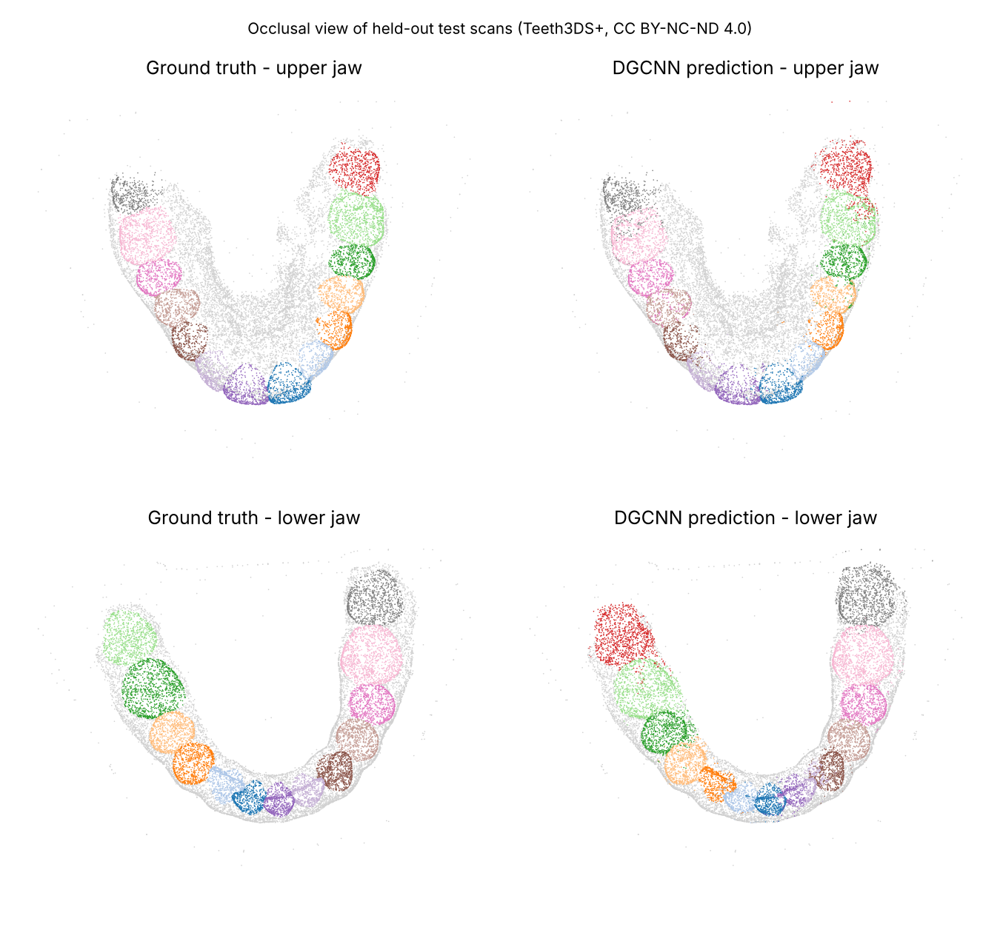
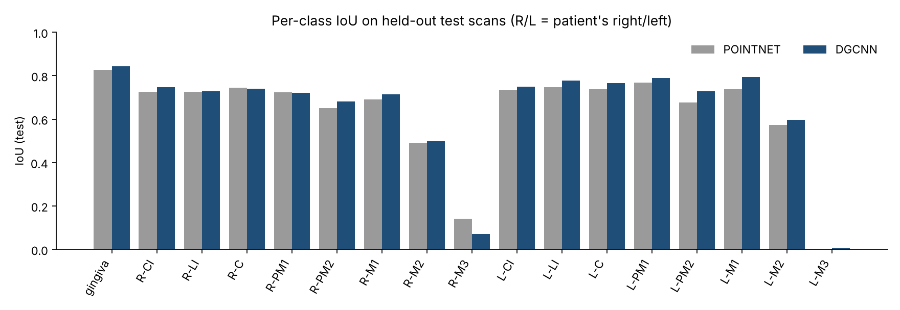
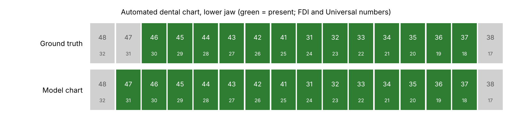
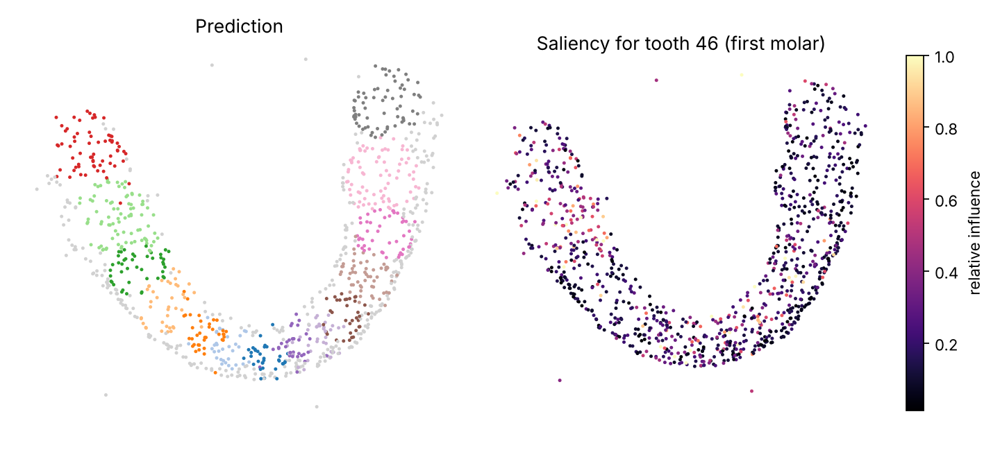
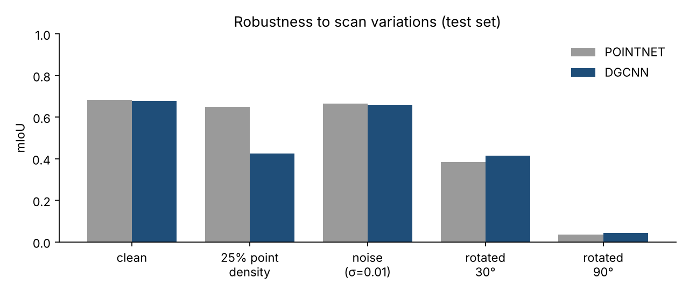

# DentChart3D

**Tooth segmentation and automated dental charting on 3D intraoral scans**

[](https://github.com/Hezarani/dentchart3d/actions/workflows/tests.yml)
 -lightgrey)

Intraoral scanners capture a 3D model of the teeth and gums at many dental visits, but the clinical
information in these scans is rarely used beyond treatment planning. DentChart3D is an open,
reproducible pipeline that **segments and numbers every tooth on a 3D intraoral scan** and turns the
result into a **dental chart** (which teeth are present or missing, in FDI, Universal and Palmer
notation). It adds **point-level explanations** and **robustness tests**, and is documented with a
**model card** and a **TRIPOD+AI / CLAIM-oriented reporting checklist**.



## At a glance

| | |
|---|---|
| Data | 300 intraoral scans (150 upper, 150 lower jaws) from the public Teeth3DS+ benchmark |
| Task | 17-class per-point segmentation per jaw (gingiva + 16 tooth positions, FDI-aligned) |
| Models | PointNet and DGCNN (EdgeConv) baselines, trained from scratch on CPU |
| Best test result | **DGCNN**: mIoU 0.705, tooth identification 92.2%, chart agreement 96.1% |
| Extras | Automated dental charting · input-gradient explanations · density/noise/rotation stress tests |
| Reproducibility | Fixed seeds, scan-level split file, unit tests, CI, one script to re-run everything |

## Results (held-out test set, 46 scans)

| Model | mIoU | Accuracy | Tooth Dice | Tooth identification | Chart agreement | Exact charts | Missing-tooth sensitivity |
|---|---|---|---|---|---|---|---|
| POINTNET | 0.687 | 84.7% | 0.814 | 90.7% | 95.8% | 56.5% | 79.8% |
| DGCNN | 0.705 | 86.2% | 0.830 | 92.2% | 96.1% | 63.0% | 81.5% |

*mIoU: mean intersection-over-union over the 17 classes, averaged per scan. Tooth identification:
share of ground-truth teeth whose points are mostly given the right tooth number. Chart agreement:
share of the 16 tooth positions per jaw correctly marked present or missing. Exact charts: share of
scans whose whole chart is correct.*

Upper vs lower jaw mIoU: POINTNET 0.741 / 0.632; DGCNN 0.742 / 0.667 (upper / lower)



### Key findings

1. **DGCNN beats PointNet on clean scans** (test mIoU 0.705 vs 0.687; tooth identification 92.2% vs 90.7%): looking at local neighbourhoods helps separate adjacent teeth.
2. **The dental chart is right for 96.1% of tooth positions** and fully correct for 63.0% of jaws. Typical errors involve second and third molars (rare in the data) and numbering shifts next to a gap, where a tooth takes its missing neighbour's number.
3. **Local-geometry models are sensitive to point density.** With 25% of the points, DGCNN drops to mIoU 0.425 while PointNet keeps 0.651. Scans from different scanner systems will need density augmentation or multi-scale graphs, which is exactly what scanner-independent clinical use requires.
4. **Orientation matters.** Rotations beyond the training range (±15°) reduce mIoU to about 0.4 at 30° and near zero at 90°, so scans must be aligned first or the model made rotation-invariant.


### From segmentation to a dental chart

Each tooth position is marked present when the model assigns enough points to it (threshold chosen on the validation set). Numbers are
converted to Universal and Palmer notation with [ToothNotation](https://github.com/Hezarani/toothnotation).



### What the model looks at

Input-gradient saliency shows which surface regions drive the decision for one tooth.



### Robustness

Scans differ between scanner systems and sessions. The models were tested, without retraining,
on sparser point sets (25% density), added coordinate noise and rotations.

| Model | Clean | 25% density | Noise σ=0.01 | Rotated 30° | Rotated 90° |
|---|---|---|---|---|---|
| POINTNET | 0.682 | 0.651 | 0.665 | 0.383 | 0.035 |
| DGCNN | 0.678 | 0.425 | 0.657 | 0.415 | 0.044 |



PointNet is almost unaffected by lower point density, while DGCNN, which relies on local
neighbourhoods, loses about a third of its mIoU. Rotations larger than those seen in training (±15°)
hurt both models: canonical orientation, or rotation-invariant features, matter for deployment
across scanners.

## Methods

- **Preprocessing:** area-weighted vertex normals; centring and unit-sphere scaling; 16,384 points per scan.
- **Input per point:** x, y, z, normal (3), jaw indicator (2) = 8 channels.
- **Labels:** gingiva + 8 tooth positions on the patient's right + 8 on the left, aligned across jaws (`dentchart3d/labels.py`).
- **PointNet:** shared MLP (64-128) + global max-pooled feature (512), trained on 2,048-point subsets, 50 epochs.
- **DGCNN:** three EdgeConv layers (k = 16; first graph on coordinates, then dynamic feature graphs), 512-d global feature, trained on 1,024-point subsets, 50 epochs.
- **Training:** AdamW (lr 1e-3, weight decay 1e-4), cosine schedule, class-weighted cross-entropy with label smoothing 0.05; augmentation by small rotations (±15°), scaling and jitter (no mirroring, which would swap left and right).
- **Whole-scan inference:** the 16,384 points are split into random chunks, each a uniform subsample of the whole jaw, and predicted with two votes.
- **Selection:** checkpoint with the best validation mIoU; the test set was used once.

## Reproduce

```bash
pip install -r requirements.txt
python scripts/download_teeth3ds.py --parts 1 --out data     # official OSF source, about 1.5 GB
python scripts/prepare_data.py --raw data/raw --out data/cache.pt
bash scripts/train_all.sh                                       # trains both models and evaluates (CPU, about 1 hour)
python scripts/make_figures.py
pytest -q
```

## Repository map

| Path | Content |
|---|---|
| `dentchart3d/labels.py` | FDI ↔ class mapping (patient-side aligned) |
| `dentchart3d/data.py` | OBJ reader, normals, normalisation, dataset and augmentation |
| `dentchart3d/models.py` | PointNet and DGCNN segmentation networks |
| `dentchart3d/train.py` | Training loop with validation-based checkpointing |
| `dentchart3d/inference.py` | Whole-scan partition inference with voting |
| `dentchart3d/metrics.py` | IoU, Dice, tooth identification, charting agreement |
| `dentchart3d/charting.py` | Dental chart in FDI / Universal / Palmer |
| `dentchart3d/explain.py` | Input-gradient saliency |
| `dentchart3d/evaluate.py` | Test evaluation and robustness tests |
| `docs/` | Model card, data notes, reporting checklist, figures |
| `results/` | Split file, training logs, per-scan and summary results |

## Limitations

- One public dataset and a 300-scan subset; no external validation and no comparison with chair-side clinical measurements.
- Compact models trained on CPU for a limited number of epochs (published GPU methods on the full benchmark report higher scores); results are baselines, not state of the art.
- The public labels contain no age, sex or scanner information, so subgroup performance could not be studied.
- Research software, not a medical device.

## Next steps

Graph neural networks directly on the mesh, gingival recession and inflammation measures from the
gingival margin, an oral-hygiene index, and prospective validation against clinical measurements.

## Data and licences

Code: MIT. Data: [Teeth3DS+](https://crns-smartvision.github.io/teeth3ds) (CC BY-NC-ND 4.0), not
redistributed; trained weights are not shared for the same reason. Figures show test scans from
Teeth3DS+ for non-commercial research illustration. Please cite the dataset:

> Ben-Hamadou A. et al. Teeth3DS+: An Extended Benchmark for Intraoral 3D Scans Analysis. arXiv:2210.06094.

## Citation

See `CITATION.cff`. Author: Hossein Boustani Hezarani, DDS (ORCID 0009-0007-8481-0498).

## Related open tools by the author

[PerioRisk](https://github.com/Hezarani/periorisk) · [DentDeID](https://github.com/Hezarani/dentdeid) · [OdontoAge](https://github.com/Hezarani/odontoage) · [ToothNotation](https://github.com/Hezarani/toothnotation) · [DentRx](https://github.com/Hezarani/dentrx) · [OraCalm](https://github.com/Hezarani/oracalm)
